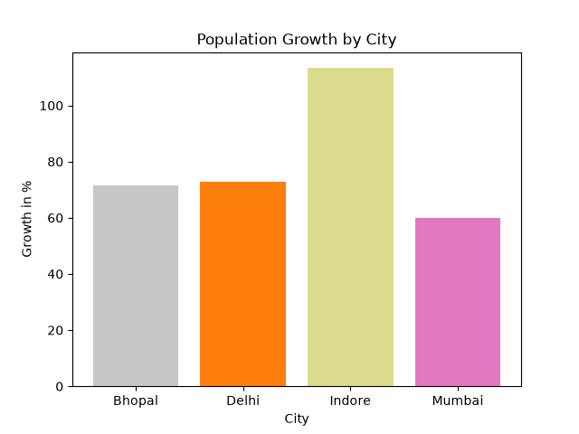
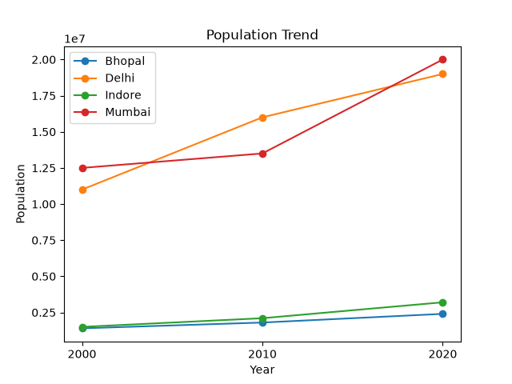

# Population Data Visualizer

**Name:** Kapil Namdeo

**Section:** M Section (SA-16)

**ERP:** RU-26-00254

## About the Project

This is a Python program that reads city population data from a CSV file and helps you understand it. It cleans the data, shows a quick summary (total population, largest city, fastest-growing city), calculates the population growth of each city in percent, and draws a bar chart and a line chart to show the results.

## Libraries Required

- Python 3.8 or newer
- pandas
- matplotlib

Install them with:

```bash
pip install pandas matplotlib
```

## Steps to Run

1. Download or clone this repository.
2. Install the required libraries.
3. Place your CSV file in the same folder as the script.
4. Run the code
5. Type the name of your CSV file when asked.
6. Choose an option from the menu:

   ```
   1. Summary
   2. Growth and charts
   3. Exit
   ```

## Sample Input

The CSV file has no header row. Each line is `City, Year, Population`.

`population.csv`

```csv
Delhi,2000,12000000
Delhi,2010,16300000
Delhi,2020,19000000
Mumbai,2000,12400000
Mumbai,2010,12500000
Mumbai,2020,12700000
Bhopal,2000,1400000
Bhopal,2010,1800000
Bhopal,2020,2400000
```

## Sample Output

```
Enter CSV File Name: population.csv
1. Summary
2. Growth and charts
3. Exit
Choose option: 1
Total population: 34100000
Largest city: Delhi (19000000)
Fastest growing city: Bhopal (+71.43%)
1. Summary
2. Growth and charts
3. Exit
Choose option: 2
Bhopal: +71.43%
Delhi: +58.33%
Mumbai: +2.42%
```

Choosing option 2 also opens two charts: a bar chart of growth by city and a line chart of population over the years.

## Screenshots

Add your screenshots here after running the program.

| Population Growth by City | Population Trend |
|---------------------------|------------------|
|  |  |
