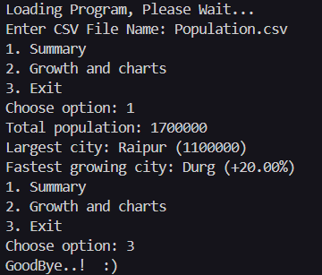
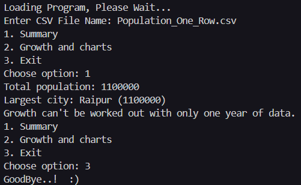
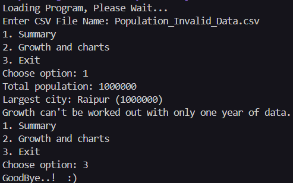
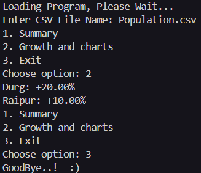
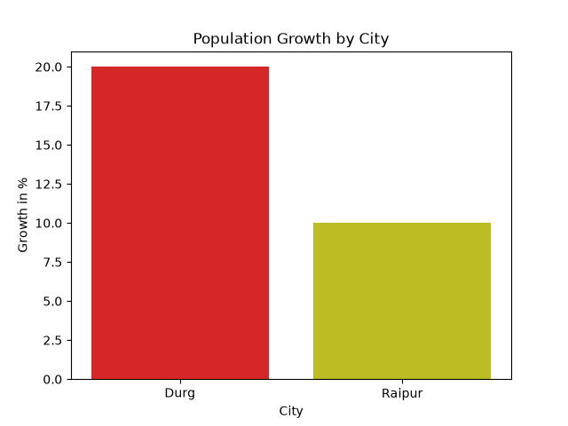
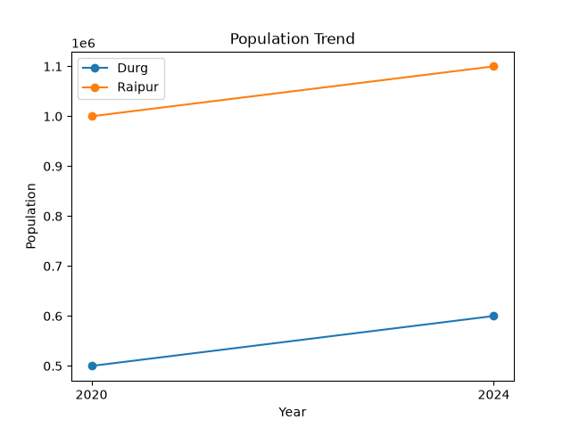

# Test Cases

## Test Case 1

**Input**

```
Raipur,2020,1000000
Raipur,2024,1100000
Durg,2020,500000
Durg,2024,600000
```

**Output (Screenshot)**




## Test Case 2

**Input**

```
Raipur,2024,1100000
```

**Output (Screenshot)**



## Test Case 3

**Input**

```
Raipur,2020,1000000
Durg,2020,abc
Bhilai,2020,-500
```

**Output**



## Test Case 4

**Input**

```
Raipur,2020,1000000
Raipur,2024,1100000
Durg,2020,500000
Durg,2024,600000
```

**Output**

| Text Output | Population Growth | Population Trend |
|-------------|-------------------|------------------|
|||